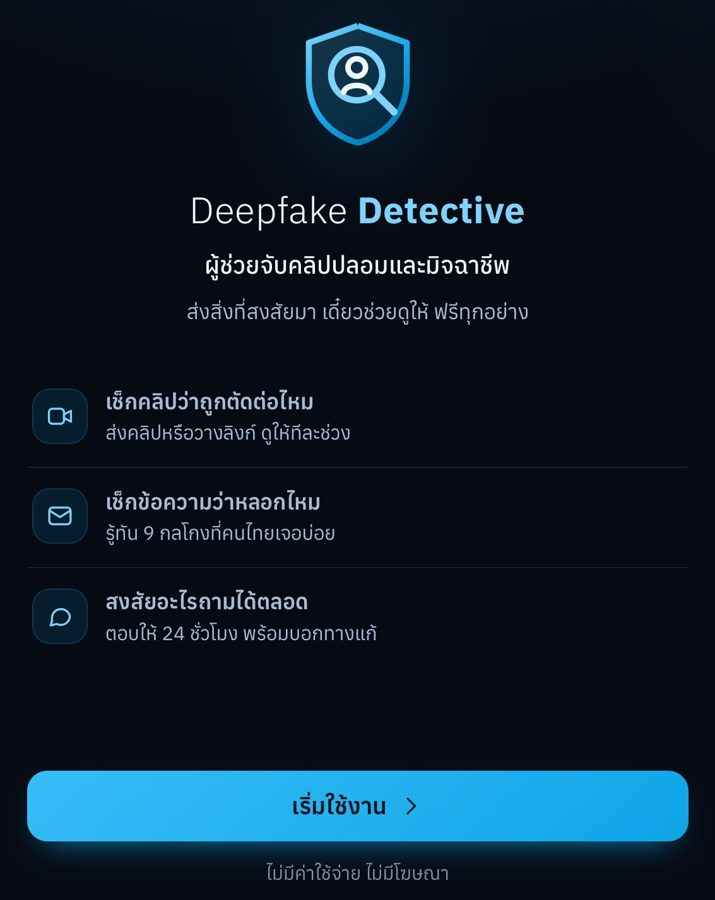
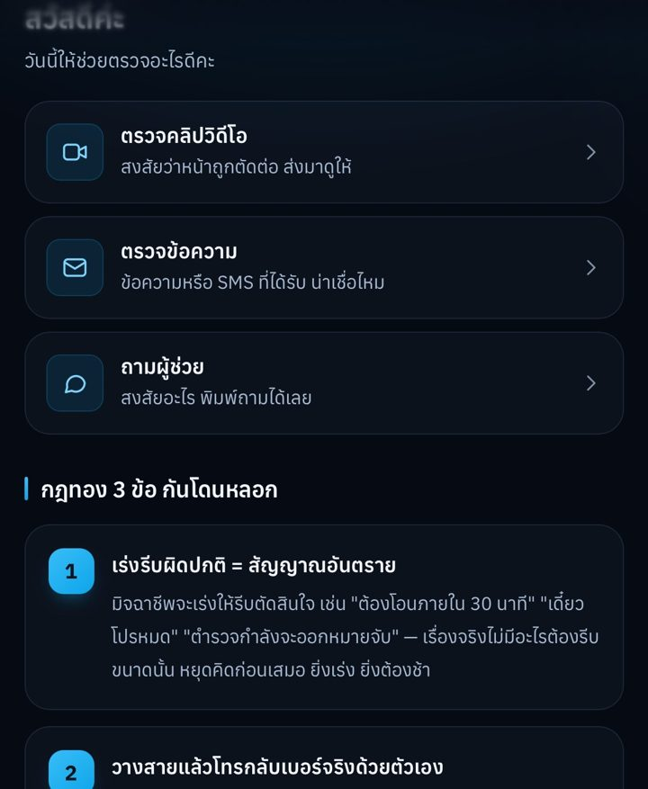
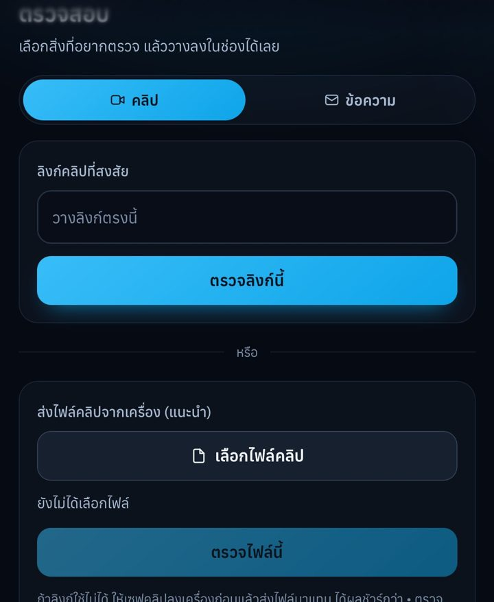
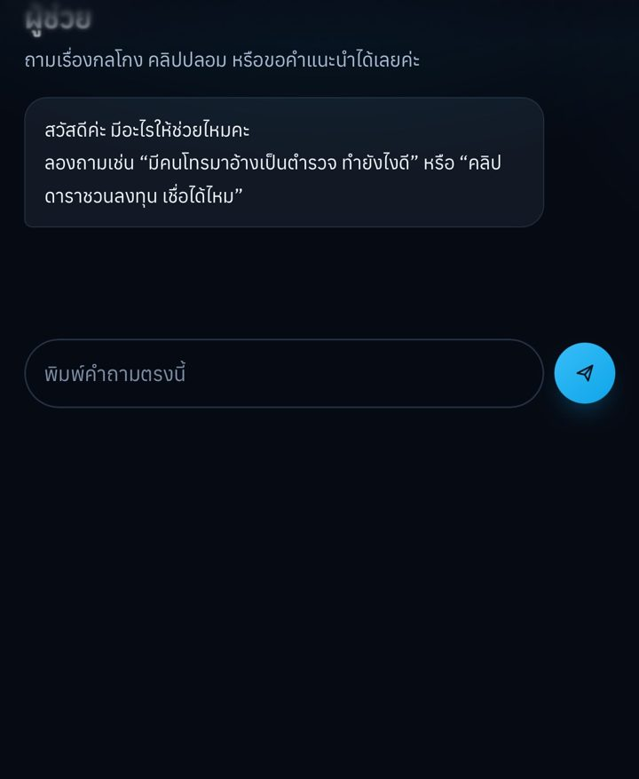
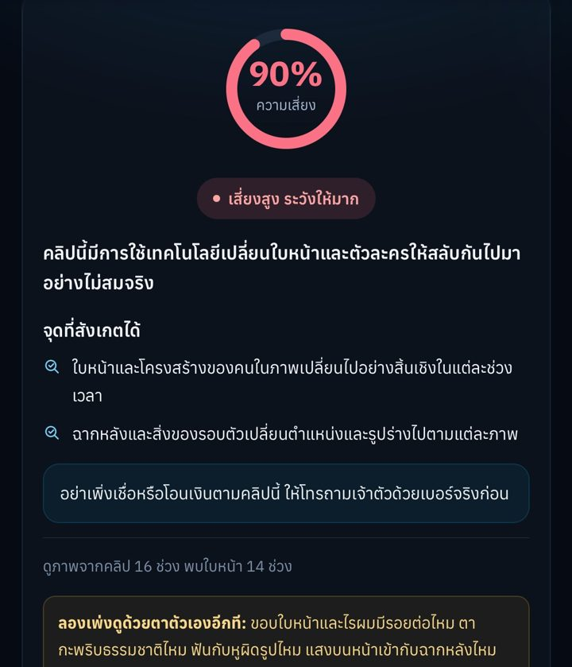
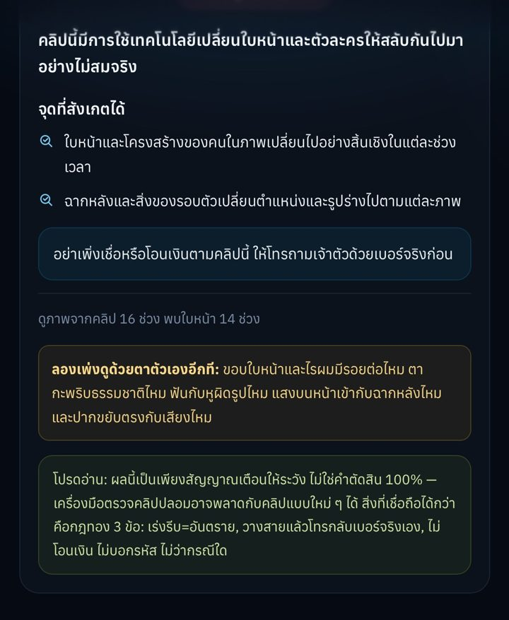

# 🛡️ Deepfake Detective — ตัวช่วยจับคลิปปลอมและมิจฉาชีพ

> 🏆 **รางวัลยอดเยี่ยม** ด้านผู้นำความมั่นคงปลอดภัยไซเบอร์รุ่นใหม่ (Young Cybersecurity Leader)
> Thailand Cybersecurity Product and Service Awards 2025 — สกมช. (NCSA)
>
> 🚀 พัฒนาต่อยอดส่งประกวด **Samsung Solve for Tomorrow 2026** และ **Thailand ICT Awards (TICTA) 2026**

🌐 **ทดลองใช้งานจริง:** https://deepfake-detector-x4ae.onrender.com
(โฮสต์ฟรีบน Render — ถ้าไม่มีคนใช้สักพักแอปจะหลับ เข้าครั้งแรกอาจรอ ~1 นาที)

**English summary:** A free, Thai-language web app (PWA) that helps children, the elderly, and rural users
check suspicious **videos, links, and text/SMS messages** for deepfakes and scams. Video analysis uses an
**ensemble of two Hugging Face image classifiers** on face crops; text analysis combines a rule-based
database of 9 common Thai scam patterns with an LLM (Google Gemini) that explains results in plain Thai.

| | | |
|:-:|:-:|:-:|
|  |  |  |
| หน้าแรก | เมนูหลัก + กฎทอง 3 ข้อ | ตรวจคลิปจากลิงก์หรือไฟล์ |
|  |  |  |
| ผู้ช่วยตอบคำถาม | ผลวิเคราะห์ความเสี่ยง | คำแนะนำหลังตรวจ |

---

## ปัญหาที่ต้องการแก้

เทคโนโลยี Deepfake ทำให้สร้างคลิปปลอมที่สมจริงได้ง่ายขึ้นมาก มิจฉาชีพนำไปใช้หลอกโอนเงิน
แอบอ้างเป็นคนรู้จัก หรือปลอมเป็นคนดังชวนลงทุน กลุ่มที่เสี่ยงที่สุดคือเด็ก ผู้สูงอายุ
และคนที่ไม่คุ้นกับเทคโนโลยี ซึ่งยังขาดเครื่องมือที่ใช้ง่ายและเป็นภาษาไทย

## ความสามารถ

- 🎬 **ตรวจคลิปวิดีโอ** — วางลิงก์หรืออัปโหลดไฟล์ ระบบวิเคราะห์ใบหน้าในแต่ละช่วงของคลิป
- 💬 **ตรวจข้อความ/SMS** — จับ 9 รูปแบบมิจฉาชีพที่พบบ่อยในไทย
- 🤖 **ผู้ช่วยตอบคำถาม** — ถามเรื่องกลโกงได้ตลอด แนะนำสายด่วน 1441 / 191 เมื่อถูกหลอก
- 📚 **เรียนรู้** — กฎทอง 3 ข้อกันโดนหลอก + แบบทดสอบ 7 ข้อ
- 👤 **ระบบสมาชิก** — รหัสผ่านเก็บแบบ hash (PBKDF2) + โหมดผู้เยี่ยมชม
- 📱 **ติดตั้งเป็นแอปบนมือถือได้ (PWA)** — ดู [INSTALL_APP.md](INSTALL_APP.md)

## ระบบ AI ทำงานอย่างไร

```
คลิป/ลิงก์ ──► ตัดเฟรม (สูงสุด 16 เฟรม) ──► ตรวจหาใบหน้า (OpenCV)
                                              │
                                   ครอปใบหน้า + เผื่อขอบ 20%
                                              │
                      ┌───────────────────────┴───────────────────────┐
              โมเดล A: deepfake-detector-model-v1      โมเดล B: Deepfake-Detect-Siglip2
                      └───────────────────────┬───────────────────────┘
                                  เฉลี่ยคะแนน (Ensemble)
                                              │
                 % ความเสี่ยง + ช่วงเวลาที่น่าสงสัย + คำอธิบายภาษาไทย (Gemini)

ข้อความ/SMS ──► จับคู่ 9 รูปแบบมิจฉาชีพ (กฎพื้นฐาน) + LLM วิเคราะห์ ──► ระดับความเสี่ยง + วิธีรับมือ
```

**เหตุผลในการออกแบบ**

- **Ensemble 2 โมเดล:** ยังไม่มีโมเดลเดี่ยวที่แม่นที่สุดกับคลิปทุกแบบ การเฉลี่ยคะแนนจากหลายโมเดลช่วยลดความผิดพลาดของโมเดลใดโมเดลหนึ่ง
- **วิเคราะห์เฉพาะใบหน้า:** โมเดลถูกฝึกจากภาพใบหน้า การครอปเฉพาะส่วนหน้าทำให้ผลตรงกับสิ่งที่โมเดลเรียนมา และถ้าไม่พบใบหน้าเลย ระบบจะตอบตรง ๆ ว่า "ประเมินไม่ได้" แทนการเดา
- **ทำงานได้แม้ไม่มี GPU:** เวอร์ชันออนไลน์ให้คะแนนผ่าน Hugging Face Inference API จึงรันบนเซิร์ฟเวอร์ฟรีได้ และถ้าไม่มี API key ระบบยังตรวจข้อความด้วยกฎพื้นฐานได้ 100%

## ⚖️ จริยธรรมและข้อจำกัด

โมเดลตรวจ Deepfake แม่นกับข้อมูลแบบที่ฝึกมา แต่อาจพลาดกับคลิปที่ใช้เทคนิคใหม่
ถ้าแอปมั่นใจผิด ผู้ใช้อาจวางใจแล้วโอนเงินให้มิจฉาชีพ ผลตรวจทุกครั้งจึงแสดงเป็น
**"สัญญาณเตือนให้ระวัง" ไม่ใช่คำตัดสิน 100%** และแอปสอน **"กฎทอง 3 ข้อ"** ควบคู่เสมอ
(เร่งรีบผิดปกติ = อันตราย / วางสายแล้วโทรกลับเบอร์จริง / ไม่โอนเงิน ไม่บอกรหัส)

## เทคโนโลยีที่ใช้

| ส่วน | เทคโนโลยี |
|---|---|
| Backend | Python, FastAPI |
| Frontend | PWA (HTML + CSS + vanilla JavaScript) |
| ตรวจ Deepfake | Hugging Face image classifiers (ensemble), OpenCV, yt-dlp |
| อธิบายผล / แชท | Google Gemini (รองรับ Claude / Ollama / โหมดกฎพื้นฐาน) |
| ฐานข้อมูลผู้ใช้ | SQLite |
| Deploy | Render, Docker |

## วิธีรันในเครื่อง

ต้องมี Python 3.10–3.12

```bash
cd backend
python -m venv venv
source venv/bin/activate           # Windows: venv\Scripts\activate
pip install -r requirements.txt     # ตัวหลัก (เบา) — ตรวจข้อความ + แชท + เรียนรู้
cp .env.example .env                # (ไม่บังคับ) ใส่ GEMINI_API_KEY ฟรีจาก aistudio.google.com/apikey
python run.py                       # เปิด http://localhost:8000
```

- ไม่มี key ก็รันได้ (โหมดกฎพื้นฐาน)
- ตรวจคลิปในเครื่อง: `pip install -r requirements-video.txt` (มี torch — ตัวหนัก, มี GPU จะเร็วกว่ามาก)

<details>
<summary>โครงสร้างโปรเจกต์ และ API</summary>

```
├── backend/
│   ├── main.py               endpoint ทั้งหมด + เสิร์ฟหน้าเว็บ
│   ├── video_pipeline.py     ตัดเฟรม → ตรวจหน้า → ensemble โมเดล → รวมผล
│   ├── ai_client.py          ตัวเชื่อม AI (gemini / claude / ollama / none)
│   ├── scam_data.py          9 รูปแบบมิจฉาชีพ + กฎทอง 3 ข้อ
│   ├── auth.py               ระบบสมาชิก SQLite + hash รหัสผ่าน
│   └── run.py
├── frontend/                 PWA (index.html, manifest.json, sw.js, ไอคอน)
├── docs/screenshots/         ภาพหน้าจอแอป
├── Dockerfile / render.yaml  สำหรับ deploy
└── INSTALL_APP.md            วิธีติดตั้งเป็นแอปบนมือถือ
```

| Method | Path | ทำอะไร |
|---|---|---|
| GET | `/api/health` | สถานะเซิร์ฟเวอร์ + โหมด AI + โมเดลวิดีโอ |
| GET | `/api/scam-patterns` | 9 รูปแบบมิจฉาชีพ |
| GET | `/api/golden-rules` | กฎทอง 3 ข้อ |
| POST | `/api/analyze-text` | วิเคราะห์ข้อความ/SMS |
| POST | `/api/analyze-video` | วิเคราะห์คลิป |
| POST | `/api/chat` | แชทกับผู้ช่วย |
| POST | `/api/register` · `/api/login` · `/api/me` · `/api/logout` | ระบบสมาชิก |

</details>

## ผู้พัฒนา

**จิรัฏฐ์ มาแสวง (Jirat Masawang)** — ทีม โรงลาบยโส, โรงเรียนยโสธรพิทยาคม จ.ยโสธร

พัฒนาโดยใช้ Claude Code เป็นผู้ช่วยเขียนโค้ด
